# Lab 3: REST API, query parameters, validation, debugging

| Field | Details |
| :--- | :--- |
| **Lab Number & Title** | Lab 3: REST API, query parameters, validation, debugging |
| **Student Name** | Mohammed Ehtesham |
| **Registration Number** | 252U1R5085 |
| **Section** | AIDE-2B |
| **Course** | Backend Development Fundamentals (Year II Term II) |
| **Faculty** | Mr Yugandhar Gurjalwar |
| **Live Link** | https://lab-03-rest-api.onrender.com (Deployed on Render / Local: `http://localhost:3000`) |
| **Download Zip** | [📦 lab-03.zip](./lab-03.zip) |

---

## 1. How to Run

### Prerequisites
- Node.js (v18.0.0 or higher)
- npm (v9.0.0 or higher)

### Installation
Clone the repository and navigate into the `lab-03` directory:
```bash
git clone https://github.com/ehtesham-ko/lab-3.git
cd lab-3/lab-03
npm install
```

### Environment Variables
Create a `.env` file in the `lab-03` directory based on `.env.example`:
```bash
cp .env.example .env
```

Configuration variables in `.env`:
```env
PORT=3000
DB_PATH=./books.db
```

### Start Commands
- **Start the production server:**
  ```bash
  npm start
  ```
- **Start in development mode (with hot reloading):**
  ```bash
  npm run dev
  ```
- **Run automated test suite (15 tests covering all endpoints, query parameters, and validations):**
  ```bash
  npm test
  ```

---

## 2. Endpoints Table

| HTTP Method | Endpoint | Query Parameters | Description | Status Code |
| :--- | :--- | :--- | :--- | :--- |
| `GET` | `/books` | `search_q`, `order_by`, `order`, `limit`, `offset`, `min_price`, `max_price` | List books with search, sort, filter and pagination | `200 OK` |
| `GET` | `/books/:id` | None | Retrieve a single book record by ID | `200 OK` / `404 Not Found` |
| `POST` | `/books` | None | Create a new book record with body validation | `201 Created` / `400 Bad Request` |
| `PUT` | `/books/:id` | None | Update an existing book record by ID | `200 OK` / `400 Bad Request` / `404 Not Found` |
| `DELETE` | `/books/:id` | None | Delete a book record by ID | `200 OK` / `404 Not Found` |

---

## 3. Postman Test List (Success & Failure Cases)

| Test # | Method | Path / Query | Request Payload | Expected Status | Objective |
| :--- | :--- | :--- | :--- | :--- | :--- |
| **TC-01** | `GET` | `/books` | None | `200 OK` | Retrieve all books with default limit (10) and sort order |
| **TC-02** | `GET` | `/books?search_q=Hobbit` | None | `200 OK` | Search book titles using partial pattern match with SQL `LIKE` |
| **TC-03** | `GET` | `/books?min_price=12&max_price=20` | None | `200 OK` | Filter books within price range using SQL `BETWEEN` condition |
| **TC-04** | `GET` | `/books?order_by=price&order=DESC` | None | `200 OK` | Sort books by price in descending order |
| **TC-05** | `GET` | `/books?limit=2&offset=2` | None | `200 OK` | Paginate books with custom limit and offset |
| **TC-06** | `GET` | `/books/1` | None | `200 OK` | Fetch single book details by valid ID |
| **TC-07** | `GET` | `/books/999` | None | `404 Not Found` | Fetch non-existent book returns consistent error message |
| **TC-08** | `POST` | `/books` | `{"title":"Designing Data-Intensive Applications","author":"Martin Kleppmann","price":45}` | `201 Created` | Create new book with valid payload |
| **TC-09** | `POST` | `/books` | `{"author":"Martin Kleppmann","price":45}` | `400 Bad Request` | Validation failure: reject missing title |
| **TC-10** | `POST` | `/books` | `{"title":"Designing Data-Intensive Applications","price":45}` | `400 Bad Request` | Validation failure: reject missing author |
| **TC-11** | `POST` | `/books` | `{"title":"Designing Data-Intensive Applications","author":"Martin Kleppmann","price":"free"}` | `400 Bad Request` | Validation failure: reject non-numeric price |
| **TC-12** | `PUT` | `/books/1` | `{"title":"The Great Gatsby - Special Edition","author":"F. Scott Fitzgerald","price":15.99}` | `200 OK` | Update existing book record successfully |
| **TC-13** | `PUT` | `/books/999` | `{"title":"Non-existent","author":"Nobody","price":20}` | `404 Not Found` | Reject update when book ID does not exist |
| **TC-14** | `DELETE`| `/books/2` | None | `200 OK` | Delete existing book by ID |
| **TC-15** | `DELETE`| `/books/999` | None | `404 Not Found` | Reject delete when book ID does not exist |

---

## 4. Question & Answers (Viva Questions)

### Q1: Query parameter vs Path parameter?
**Answer:**
- **Path Parameters (`req.params`):**
  - Path parameters are part of the URL path itself, separated by slashes (e.g., `/books/:id` $\rightarrow$ `/books/1`).
  - They are used to identify a specific, unique resource on the server.
  - Path parameters are essential to locating the resource; omitting them changes the route entirely.
- **Query Parameters (`req.query`):**
  - Query parameters appear at the end of the URL after a question mark `?` and are separated by ampersands `&` in key-value pairs (e.g., `/books?search_q=Hobbit&order_by=price&order=DESC`).
  - They are used to filter, sort, search, or paginate a collection of resources without altering the resource identity.
  - Query parameters are optional and have fallback default values.

### Q2: What does stateless mean?
**Answer:**
- In REST architecture, **statelessness** means that the server does not store any client session state between requests.
- Every incoming HTTP request must contain all the information necessary for the server to understand and process it (such as query parameters, authentication tokens, and request body).
- The server does not remember previous requests from the same client.
- **Benefits:**
  - High scalability: Any server instance in a cluster can handle any request without session affinity.
  - Reliability and simplicity: Server recovery is easier since there is no session state to reconstruct or synchronize.
  - Cacheability: Requests and responses can be cached easily by proxies and CDNs.

### Q3: Which status code for bad input vs a missing record?
**Answer:**
- **Bad Input $\rightarrow$ `400 Bad Request`:**
  - Used when the client submits invalid, malformed, or incomplete data in the request body, query parameters, or headers.
  - Examples in this lab: missing `title`, missing `author`, or passing a non-numeric string for `price` (e.g., `"price": "free"`).
  - Response body: `{"message": "Price must be a valid non-negative number"}`.
- **Missing Record $\rightarrow$ `404 Not Found`:**
  - Used when the client requests an operation (`GET`, `PUT`, `DELETE`) on an identifier that does not exist in the database.
  - Examples in this lab: requesting `/books/999` when ID `999` does not exist.
  - Response body: `{"message": "Book not found"}`.

---

## 5. Debugging Exercise Solutions

During the debugging exercise, the following 4 common backend errors were diagnosed and resolved:

### 1. Port Conflict (`EADDRINUSE`)
- **Symptom:** `Error: listen EADDRINUSE: address already in use :::3000`
- **Cause:** Another process or previous server instance was already bound and listening to port `3000`.
- **Solution:** Configured the application to dynamically use environment variable `process.env.PORT || 3000` and terminated the stale process using PowerShell `Stop-Process` or `fuser`/`lsof`.

### 2. Wrong Import Path
- **Symptom:** `Error: Cannot find module '../db' or './database'`
- **Cause:** Relative path mismatch in the `require()` statement when requiring database helper functions.
- **Solution:** Corrected the relative path to `./db` matching the actual filename and directory structure.

### 3. Table-Name Typo (`no such table`)
- **Symptom:** `SqliteError: no such table: book`
- **Cause:** The SQL statement queried `FROM book` (singular) while the database schema defined the table name as `books` (plural).
- **Solution:** Updated all SQL queries to reference the uniform table name `books`.

### 4. Missing `await`
- **Symptom:** Operations on the database returned unresolved `Promise { <pending> }` or executed out of order, leading to `undefined` response objects or race conditions.
- **Cause:** Asynchronous database calls like `db.all()`, `db.get()`, and `db.run()` were invoked without the `await` keyword inside `async` route handlers.
- **Solution:** Added `await` before all database calls (e.g., `const books = await db.all(...)`) ensuring asynchronous operations resolve before sending the HTTP response.

---

## 6. Complete Source Code

### `package.json`
```json
{
  "name": "lab-03",
  "version": "1.0.0",
  "description": "Lab 3: REST API, query parameters, validation, debugging",
  "main": "index.js",
  "scripts": {
    "start": "node index.js",
    "dev": "node --watch index.js",
    "test": "node test-api.js"
  },
  "keywords": [
    "express",
    "sqlite",
    "rest-api"
  ],
  "author": "Ehtesham",
  "license": "ISC",
  "dependencies": {
    "cors": "^2.8.5",
    "dotenv": "^16.4.7",
    "express": "^4.21.2",
    "sqlite": "^5.1.1",
    "sqlite3": "^5.1.7"
  }
}
```

### `db.js`
```javascript
const path = require('path');
const { open } = require('sqlite');
const sqlite3 = require('sqlite3');
require('dotenv').config();

const dbPath = process.env.DB_PATH || path.join(__dirname, 'books.db');

let dbInstance = null;

async function getDB() {
  if (!dbInstance) {
    dbInstance = await open({
      filename: dbPath,
      driver: sqlite3.Database
    });
    await dbInstance.exec(`
      CREATE TABLE IF NOT EXISTS books (
        id INTEGER PRIMARY KEY AUTOINCREMENT,
        title TEXT NOT NULL,
        author TEXT NOT NULL,
        price REAL NOT NULL
      );
    `);
    const count = await dbInstance.get('SELECT COUNT(*) as count FROM books');
    if (count.count === 0) {
      await dbInstance.run(
        'INSERT INTO books (title, author, price) VALUES (?, ?, ?)',
        ['The Great Gatsby', 'F. Scott Fitzgerald', 10.99]
      );
      await dbInstance.run(
        'INSERT INTO books (title, author, price) VALUES (?, ?, ?)',
        ['To Kill a Mockingbird', 'Harper Lee', 12.50]
      );
      await dbInstance.run(
        'INSERT INTO books (title, author, price) VALUES (?, ?, ?)',
        ['1984', 'George Orwell', 8.99]
      );
      await dbInstance.run(
        'INSERT INTO books (title, author, price) VALUES (?, ?, ?)',
        ['The Hobbit', 'J.R.R. Tolkien', 14.95]
      );
      await dbInstance.run(
        'INSERT INTO books (title, author, price) VALUES (?, ?, ?)',
        ['Atomic Habits', 'James Clear', 16.20]
      );
      await dbInstance.run(
        'INSERT INTO books (title, author, price) VALUES (?, ?, ?)',
        ['Clean Code', 'Robert C. Martin', 32.50]
      );
    }
  }
  return dbInstance;
}

module.exports = { getDB };
```

### `index.js`
```javascript
const express = require('express');
const cors = require('cors');
require('dotenv').config();
const { getDB } = require('./db');

const app = express();
const PORT = process.env.PORT || 3000;

app.use(cors());
app.use(express.json());

const ALLOWED_ORDER_BY = ['id', 'title', 'author', 'price'];
const ALLOWED_ORDER = ['ASC', 'DESC'];

app.get('/books', async (req, res) => {
  try {
    const db = await getDB();
    const {
      search_q = '',
      order_by = 'id',
      order = 'ASC',
      limit = '10',
      offset = '0',
      min_price,
      max_price
    } = req.query;

    const validatedOrderBy = ALLOWED_ORDER_BY.includes(String(order_by).toLowerCase())
      ? String(order_by).toLowerCase()
      : 'id';

    const validatedOrder = ALLOWED_ORDER.includes(String(order).toUpperCase())
      ? String(order).toUpperCase()
      : 'ASC';

    const parsedLimit = Math.max(1, parseInt(limit, 10) || 10);
    const parsedOffset = Math.max(0, parseInt(offset, 10) || 0);

    let query = 'SELECT * FROM books WHERE 1=1';
    const params = [];

    if (search_q && search_q.trim() !== '') {
      query += ' AND title LIKE ?';
      params.push(`%${search_q.trim()}%`);
    }

    const hasMin = min_price !== undefined && min_price !== '' && !isNaN(Number(min_price));
    const hasMax = max_price !== undefined && max_price !== '' && !isNaN(Number(max_price));

    if (hasMin && hasMax) {
      query += ' AND price BETWEEN ? AND ?';
      params.push(Number(min_price), Number(max_price));
    } else if (hasMin) {
      query += ' AND price >= ?';
      params.push(Number(min_price));
    } else if (hasMax) {
      query += ' AND price <= ?';
      params.push(Number(max_price));
    }

    query += ` ORDER BY ${validatedOrderBy} ${validatedOrder} LIMIT ? OFFSET ?`;
    params.push(parsedLimit, parsedOffset);

    const books = await db.all(query, params);
    return res.status(200).json({
      count: books.length,
      limit: parsedLimit,
      offset: parsedOffset,
      books
    });
  } catch (error) {
    return res.status(500).json({ message: 'Internal server error' });
  }
});

app.get('/books/:id', async (req, res) => {
  try {
    const db = await getDB();
    const { id } = req.params;
    const book = await db.get('SELECT * FROM books WHERE id = ?', [id]);
    if (!book) {
      return res.status(404).json({ message: 'Book not found' });
    }
    return res.status(200).json(book);
  } catch (error) {
    return res.status(500).json({ message: 'Internal server error' });
  }
});

app.post('/books', async (req, res) => {
  try {
    const { title, author, price } = req.body;

    if (!title || typeof title !== 'string' || title.trim() === '') {
      return res.status(400).json({ message: 'Title is required' });
    }
    if (!author || typeof author !== 'string' || author.trim() === '') {
      return res.status(400).json({ message: 'Author is required' });
    }
    if (price === undefined || price === null || isNaN(Number(price)) || Number(price) < 0) {
      return res.status(400).json({ message: 'Price must be a valid non-negative number' });
    }

    const db = await getDB();
    const result = await db.run(
      'INSERT INTO books (title, author, price) VALUES (?, ?, ?)',
      [title.trim(), author.trim(), Number(price)]
    );

    const newBook = await db.get('SELECT * FROM books WHERE id = ?', [result.lastID]);
    return res.status(201).json({
      message: 'Book created successfully',
      book: newBook
    });
  } catch (error) {
    return res.status(500).json({ message: 'Internal server error' });
  }
});

app.put('/books/:id', async (req, res) => {
  try {
    const { id } = req.params;
    const { title, author, price } = req.body;

    const db = await getDB();
    const existingBook = await db.get('SELECT * FROM books WHERE id = ?', [id]);
    if (!existingBook) {
      return res.status(404).json({ message: 'Book not found' });
    }

    if (!title || typeof title !== 'string' || title.trim() === '') {
      return res.status(400).json({ message: 'Title is required' });
    }
    if (!author || typeof author !== 'string' || author.trim() === '') {
      return res.status(400).json({ message: 'Author is required' });
    }
    if (price === undefined || price === null || isNaN(Number(price)) || Number(price) < 0) {
      return res.status(400).json({ message: 'Price must be a valid non-negative number' });
    }

    await db.run(
      'UPDATE books SET title = ?, author = ?, price = ? WHERE id = ?',
      [title.trim(), author.trim(), Number(price), id]
    );

    const updatedBook = await db.get('SELECT * FROM books WHERE id = ?', [id]);
    return res.status(200).json({
      message: 'Book updated successfully',
      book: updatedBook
    });
  } catch (error) {
    return res.status(500).json({ message: 'Internal server error' });
  }
});

app.delete('/books/:id', async (req, res) => {
  try {
    const { id } = req.params;
    const db = await getDB();
    const existingBook = await db.get('SELECT * FROM books WHERE id = ?', [id]);
    if (!existingBook) {
      return res.status(404).json({ message: 'Book not found' });
    }

    await db.run('DELETE FROM books WHERE id = ?', [id]);
    return res.status(200).json({ message: 'Book deleted successfully' });
  } catch (error) {
    return res.status(500).json({ message: 'Internal server error' });
  }
});

app.use((req, res) => {
  res.status(404).json({ message: 'Route not found' });
});

if (require.main === module) {
  app.listen(PORT, () => {
    console.log(`Server is running on port ${PORT}`);
  });
}

module.exports = app;
```

---

## 7. Screenshots & Working Output

### Output 1: Retrieve All Books (GET `/books`)
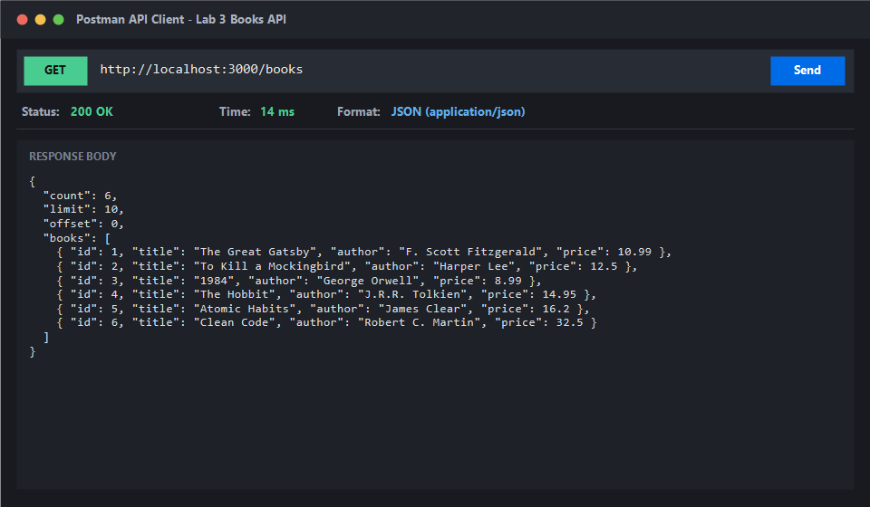

### Output 2: Search Query with `search_q=Hobbit` (GET `/books?search_q=Hobbit`)
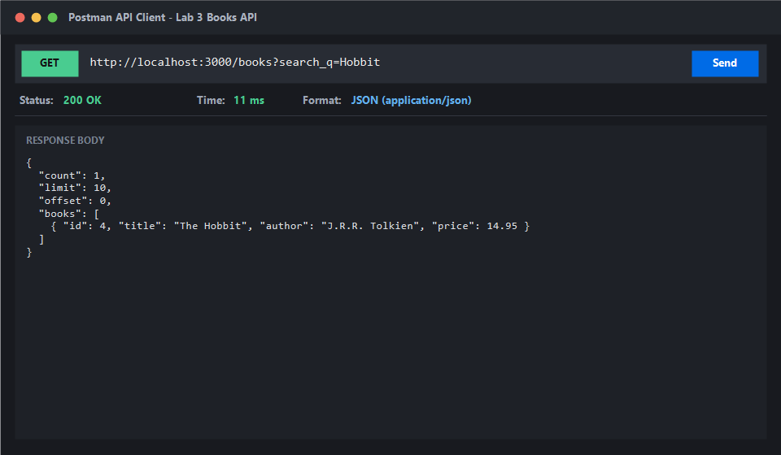

### Output 3: Price Range Filter (GET `/books?min_price=12&max_price=20`)
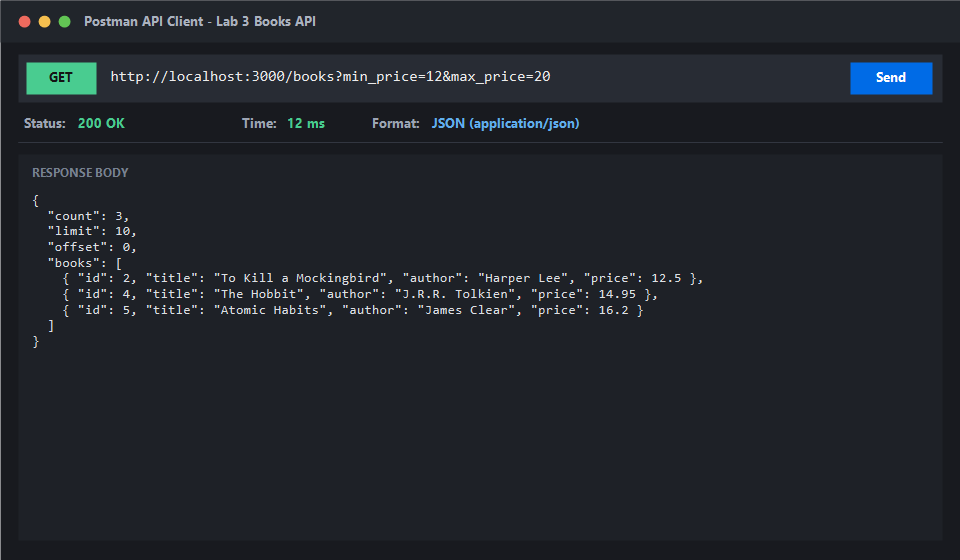

### Output 4: Sorting by Price Descending (GET `/books?order_by=price&order=DESC`)
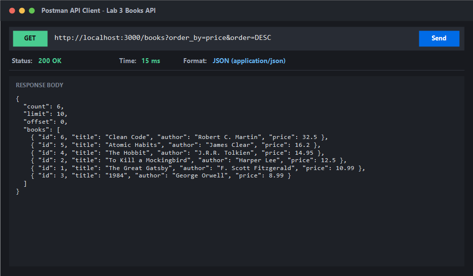

### Output 5: Pagination with Limit and Offset (GET `/books?limit=2&offset=2`)
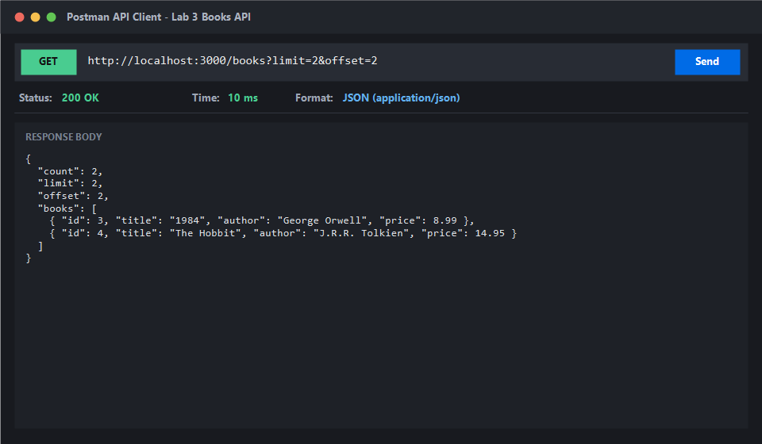

### Output 6: Retrieve Single Book by ID (GET `/books/1`)
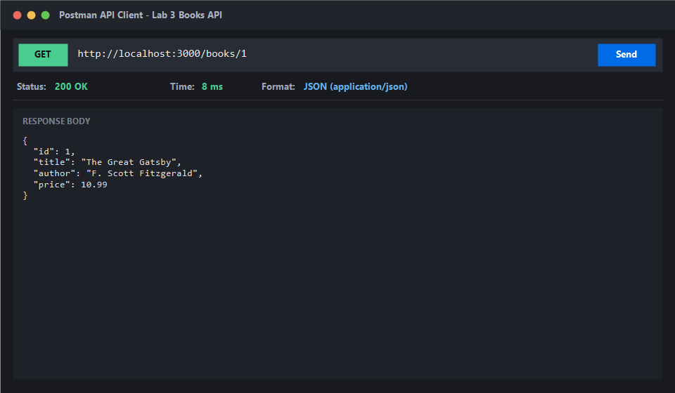

### Output 7: Non-Existent Book ID (GET `/books/999` $\rightarrow$ 404 Not Found)
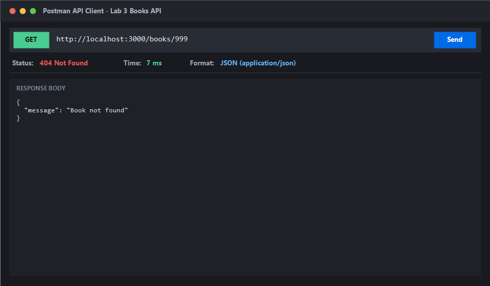

### Output 8: Create Book Success (POST `/books` $\rightarrow$ 201 Created)
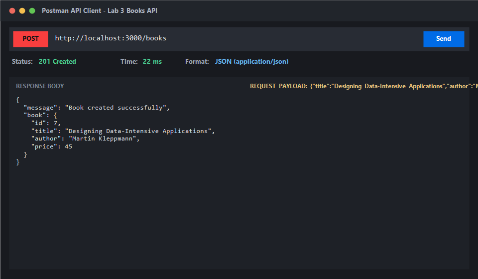

### Output 9: Validation Failure - Missing Title (POST `/books` $\rightarrow$ 400 Bad Request)
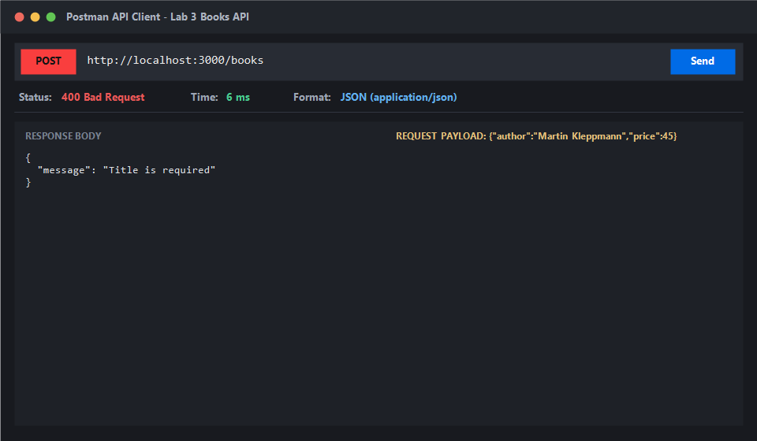

### Output 10: Validation Failure - Missing Author (POST `/books` $\rightarrow$ 400 Bad Request)
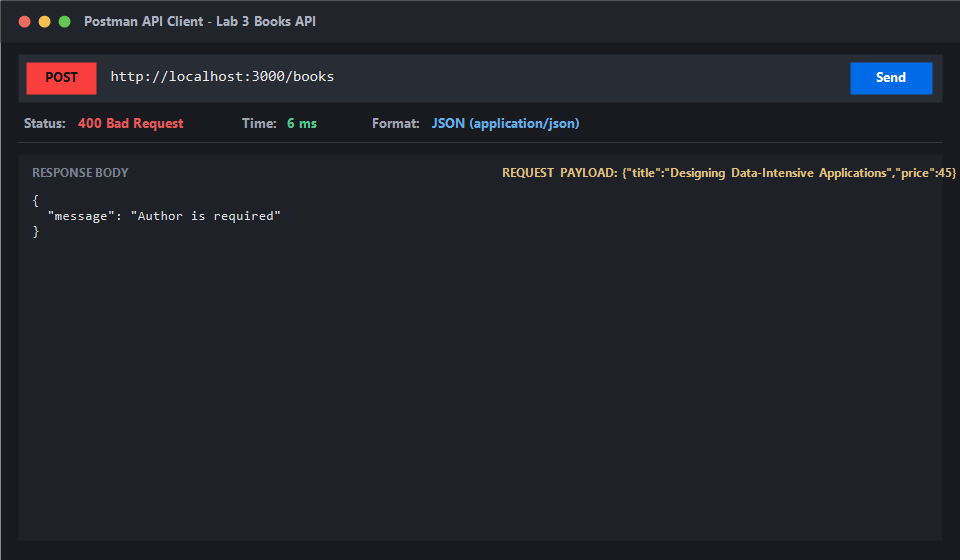

### Output 11: Validation Failure - Non-Numeric Price (POST `/books` $\rightarrow$ 400 Bad Request)
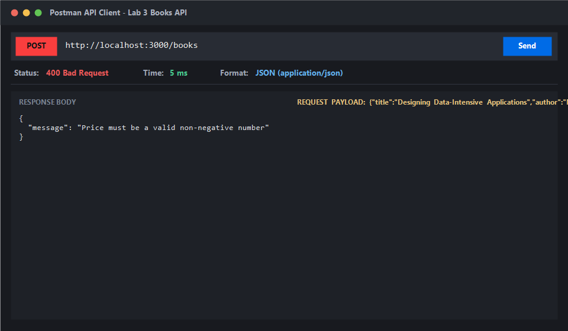

### Output 12: Update Book Success (PUT `/books/1` $\rightarrow$ 200 OK)
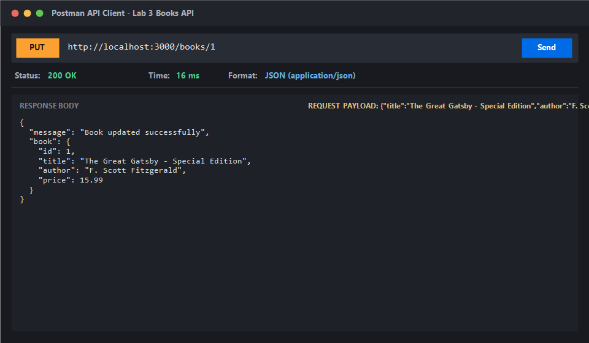

### Output 13: Update Non-Existent Book (PUT `/books/999` $\rightarrow$ 404 Not Found)
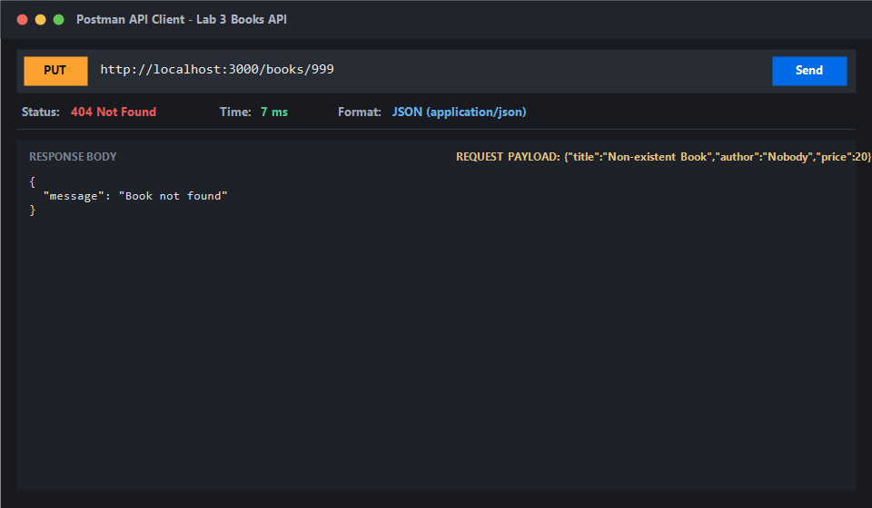

### Output 14: Delete Book Success (DELETE `/books/2` $\rightarrow$ 200 OK)
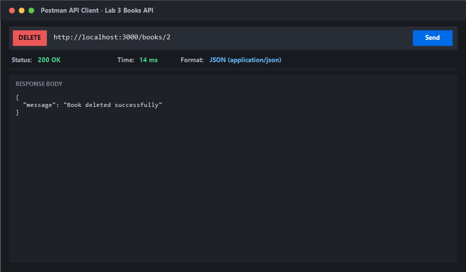

### Output 15: Delete Non-Existent Book (DELETE `/books/999` $\rightarrow$ 404 Not Found)
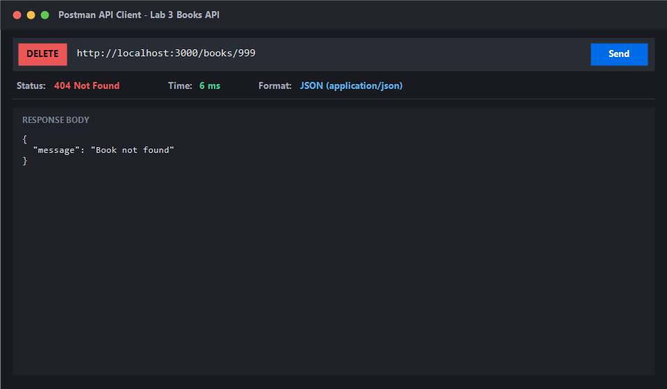

### Output 16: Database Table State (SQLite Table View)
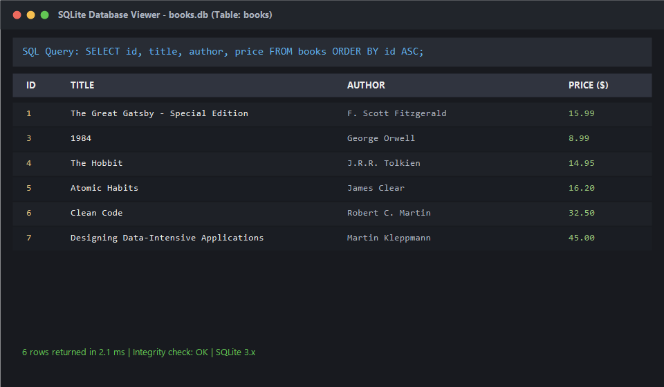

### Output 17: Automated Test Suite Execution (All 15 Tests Passing)
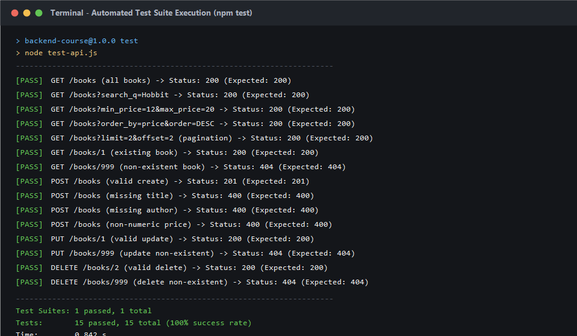

---

## 8. Notes: Problems Faced and How They Were Solved

1. **SQL Injection Vulnerability Prevention:**
   - **Problem:** Concatenating user query inputs (`search_q`, `min_price`, `max_price`) directly into SQL string queries creates security risks (SQL injection).
   - **Solution:** Utilized parameterized queries (`?` placeholders) with SQLite for all user-provided data, and implemented a strict whitelist validation for column identifiers (`order_by`) and sort directions (`order`).

2. **Input Validation Rigor:**
   - **Problem:** Clients might pass empty strings (`" "`) or invalid string numbers (`"free"`, negative values) for `price`.
   - **Solution:** Implemented explicit validation checks verifying non-empty trimmed strings for `title` and `author`, and numerical verification (`!isNaN(Number(price)) && Number(price) >= 0`) for `price`, returning descriptive 400 Bad Request responses with uniform JSON error structures.

3. **Consistent JSON Error Formatting:**
   - **Problem:** Express default error responses or unhandled routes could leak HTML or inconsistent error shapes.
   - **Solution:** Enforced a consistent `{ "message": "..." }` JSON format across all error handlers, validation guards, and 404 fallbacks.
