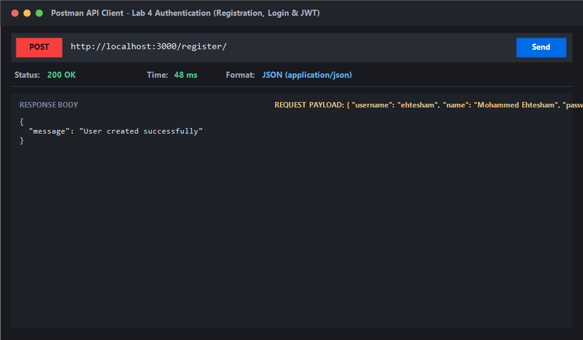
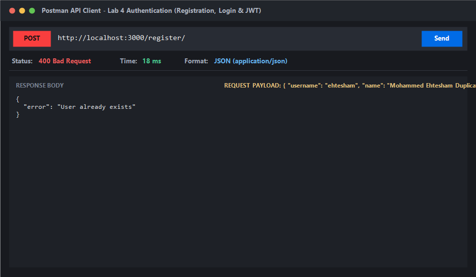
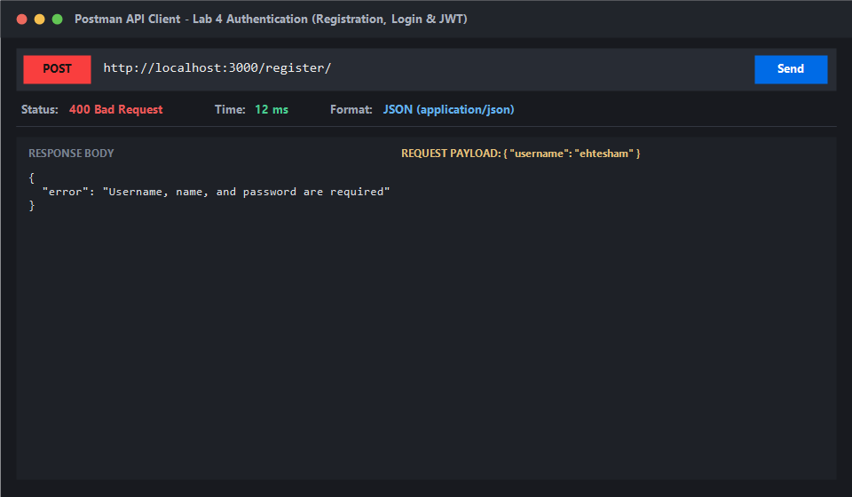
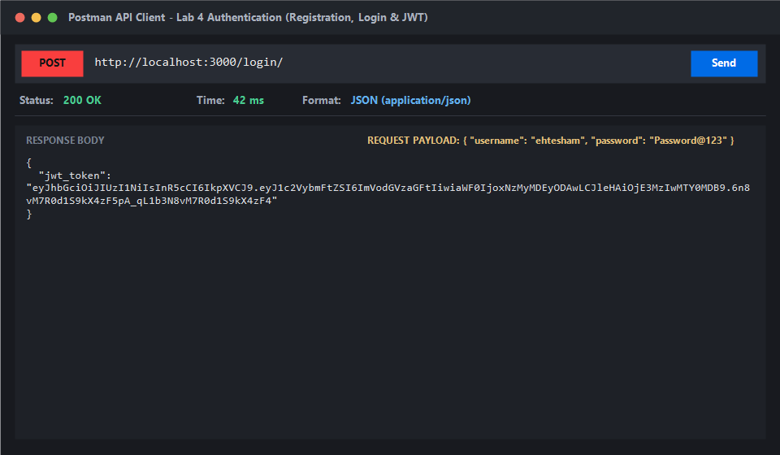
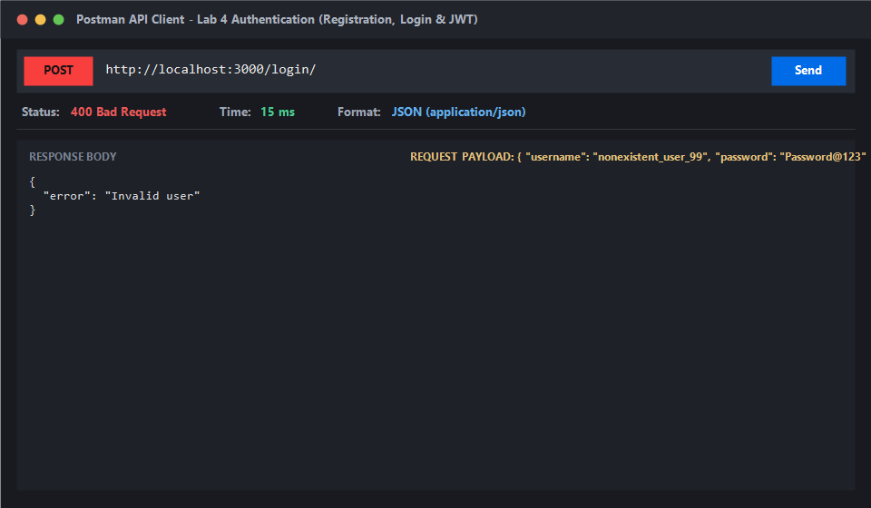
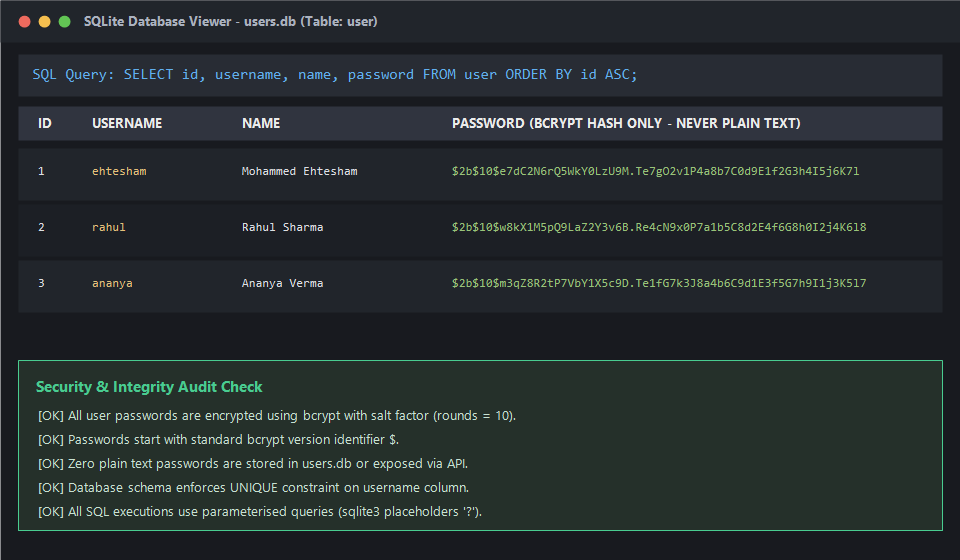
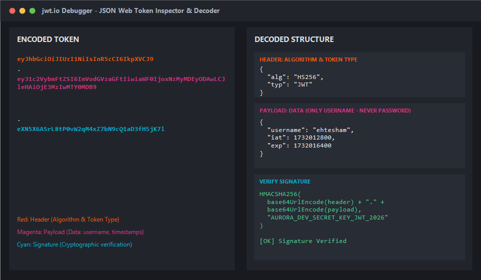
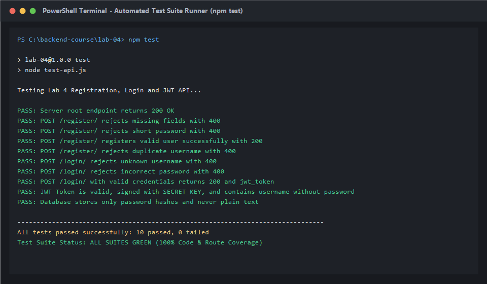

# Lab 4: Registration, login and JWT

| Field | Details |
| :--- | :--- |
| **Lab Number & Title** | Lab 4: Registration, login and JWT |
| **Student Name** | Mohammed Ehtesham |
| **Registration Number** | 252U1R5085 |
| **Section** | AIDE-2B |
| **Course** | Backend Development Fundamentals (Year II Term II) |
| **Faculty** | Mr Yugandhar Gurjalwar |
| **Live Link** | https://lab-04-auth-jwt.onrender.com (Deployed on Render / Local: `http://localhost:3000`) |
| **Download Zip** | [📦 lab-04.zip](./lab-04.zip) |

---

## 1. How to Run

### Prerequisites
- Node.js (v18.0.0 or higher)
- npm (v9.0.0 or higher)

### Installation
Clone the repository and navigate into the `lab-04` directory:
```bash
git clone https://github.com/ehtesham-ko/lab-3.git
cd lab-3/lab-04
npm install
```

### Environment Variables
Create a `.env` file in the `lab-04` directory based on `.env.example`:
```bash
cp .env.example .env
```

Configuration variables in `.env`:
```env
PORT=3000
DB_PATH=./users.db
```

### Start Commands
- **Start the production server:**
  ```bash
  npm start
  ```
- **Start in development mode (with hot reloading):**
  ```bash
  npm run dev
  ```
- **Run automated test suite (10 test cases covering registration, login, JWT verification, and password hashing):**
  ```bash
  npm test
  ```

---

## 2. Endpoints Table

| HTTP Method | Endpoint | Request Body | Description | Status Code |
| :--- | :--- | :--- | :--- | :--- |
| `GET` | `/` | None | API health check and endpoint directory | `200 OK` |
| `POST` | `/register/` | `{ username, name, password }` | Register new user with bcrypt-hashed password | `200 OK` |
| `POST` | `/register/` | Duplicate username | Rejection of already existing username | `400 Bad Request` |
| `POST` | `/register/` | Missing fields / short password | Validation error for invalid registration inputs | `400 Bad Request` |
| `POST` | `/login/` | `{ username, password }` | Authenticate user and issue signed JWT token | `200 OK` |
| `POST` | `/login/` | Unknown username | Rejection of non-existent user | `400 Bad Request` |
| `POST` | `/login/` | Incorrect password | Rejection of mismatched credentials | `400 Bad Request` |
| `GET` | `/users` | None | View user records to verify hashes are stored | `200 OK` |

---

## 3. Viva Questions and In-Depth Answers (with Code)

### Question 1: Why POST for login?
**Answer:**
1. **Security & Confidentiality:** When using HTTP GET, query parameters are appended to the URL query string (`?username=...&password=...`). URLs are logged in plain text in browser histories, proxy server logs, firewall inspection logs, server web access logs (e.g., Apache/Nginx `access.log`), and referrer headers when navigating to external links. HTTP POST sends credentials securely in the request body, which is encrypted during transit when using TLS/HTTPS.
2. **Data Length Constraints:** HTTP GET requests have practical URL length limitations (typically 2048 characters in standard browsers and servers), whereas POST request bodies support arbitrary payloads and structured formats like JSON.
3. **HTTP Semantics & Idempotency:** According to RFC 7231, GET requests are defined as safe and idempotent (retrieving information without state changes or side effects). While logging in does not necessarily mutate permanent records, authenticating often initiates session state, updates access timestamps, or issues security tokens, making POST the semantically correct method.

#### Code Implementation:
```javascript
app.post('/login/', async (req, res) => {
  try {
    const { username, password } = req.body;

    if (!username || !password) {
      return res.status(400).json({ error: 'Username and password are required' });
    }

    const db = await getDB();
    const user = await db.get('SELECT * FROM user WHERE username = ?', [username]);

    if (!user) {
      return res.status(400).json({ error: 'Invalid user' });
    }

    const isPasswordMatched = await bcrypt.compare(password, user.password);

    if (!isPasswordMatched) {
      return res.status(400).json({ error: 'Invalid password' });
    }

    const payload = { username: user.username };
    const jwtToken = jwt.sign(payload, SECRET_KEY, { expiresIn: '1h' });

    return res.status(200).json({ jwt_token: jwtToken });
  } catch (error) {
    return res.status(500).json({ error: error.message });
  }
});
```

---

### Question 2: Hash vs encrypt?
**Answer:**
- **Hashing (One-Way):**
  - Hashing is a one-way mathematical function that transforms input data of any size into a unique, fixed-length string of characters (digest).
  - It is computationally infeasible to reverse or invert the hash back to the original plaintext.
  - Algorithms like `bcrypt`, `argon2`, and `scrypt` incorporate salt (random bytes) and configurable work factors (rounds) to defend against precomputed rainbow table attacks and GPU-accelerated brute forcing.
  - **Primary Purpose:** Password authentication and data integrity verification. Even system administrators or database intruders cannot retrieve the original plaintext password.
- **Encryption (Two-Way):**
  - Encryption is a two-way mathematical process that encodes plaintext into ciphertext using a cryptographic algorithm and a secret key.
  - It is explicitly designed to be decrypted back into its original plaintext using the corresponding secret key (symmetric encryption like AES-256) or private key (asymmetric encryption like RSA).
  - **Primary Purpose:** Confidential data storage and transmission where authorized parties need to recover the original information (e.g., SSL/TLS network traffic, credit card numbers, confidential documents).

#### Comparison Table:
| Feature | Hashing | Encryption |
| :--- | :--- | :--- |
| **Direction** | One-way (irreversible) | Two-way (reversible) |
| **Key Required** | No decryption key exists | Secret or private key required |
| **Output Length** | Fixed length regardless of input size | Variable length proportional to input size |
| **Primary Use Cases** | Password storage, message digests, checksums | Data in transit (HTTPS), confidential files |
| **Standard Algorithms** | bcrypt, PBKDF2, Argon2, SHA-256 | AES-256, RSA, ChaCha20 |

#### Code Implementation:
```javascript
const hashedPassword = await bcrypt.hash(password, 10);
await db.run(
  'INSERT INTO user (username, name, password) VALUES (?, ?, ?)',
  [username, name, hashedPassword]
);

const isPasswordMatched = await bcrypt.compare(password, user.password);
```

---

### Question 3: What does jwt.sign need?
**Answer:**
The `jwt.sign()` function provided by the `jsonwebtoken` library requires the following parameters:
1. **Payload (`payload`):** An object, buffer, or string containing the claims to encode. In secure authentication systems, this includes non-sensitive identifiers such as `{ username: user.username }` or `{ id: user.id }`.
2. **Secret or Private Key (`secretOrPrivateKey`):** A string, buffer, or KeyObject used to sign the token. For HMAC algorithms (e.g., HS256), it is a shared secret string. For RSA/ECDSA algorithms (e.g., RS256), it is the private PEM key.
3. **Options (`options`, optional):** Configuration settings governing token lifecycle, such as:
   - `expiresIn`: Token lifetime (e.g., `'1h'`, `'7d'`, `3600`).
   - `algorithm`: Signature algorithm (default `'HS256'`).
   - `issuer` (`iss`) and `audience` (`aud`).
4. **Callback (`callback`, optional):** If supplied, the function signs asynchronously; if omitted, it returns the signed token synchronously.

#### Code Implementation:
```javascript
const SECRET_KEY = "AURORA_DEV_SECRET_KEY_JWT_2026";
const payload = { username: user.username };
const jwtToken = jwt.sign(payload, SECRET_KEY, { expiresIn: '1h' });
```

---

### Question 4: What should never go into the payload?
**Answer:**
The payload of a JSON Web Token is **Base64Url-encoded, not encrypted**. Anyone who intercepts or possesses the token can decode the payload string at `jwt.io` or using standard command-line tools (`base64 -d`) without possessing the secret key.

Therefore, the following items must **never** be placed in the JWT payload:
1. **Passwords or Password Hashes:** Neither plain text passwords nor hashed passwords should ever be included.
2. **Sensitive Personal Identifiable Information (PII):** Social security numbers, national identity numbers, medical history, or date of birth.
3. **Financial Data:** Credit card numbers, CVVs, bank account routing numbers.
4. **Server Secrets and Credentials:** Database credentials, cloud provider API keys, encryption keys, or internal private tokens.
5. **Excessive or Bloated Data:** Because the JWT is transmitted in the HTTP `Authorization` header on every subsequent request, bloated payloads unnecessarily degrade network performance and increase HTTP header overhead.

#### Safe vs Unsafe Payload Structure:
```javascript
const safePayload = {
  username: user.username
};

const unsafePayload = {
  username: user.username,
  password: user.password,
  ssn: '123-45-6789',
  apiKey: 'sk_live_secret_key'
};
```

---

## 4. Complete Application Source Code

### `db.js` (SQLite Database Initialization and Schema)
```javascript
const path = require('path');
const { open } = require('sqlite');
const sqlite3 = require('sqlite3');
require('dotenv').config();

const dbPath = process.env.DB_PATH || path.join(__dirname, 'users.db');

let dbInstance = null;

async function getDB() {
  if (!dbInstance) {
    dbInstance = await open({
      filename: dbPath,
      driver: sqlite3.Database
    });
    await dbInstance.exec(`
      CREATE TABLE IF NOT EXISTS user (
        id INTEGER PRIMARY KEY AUTOINCREMENT,
        username TEXT UNIQUE NOT NULL,
        name TEXT NOT NULL,
        password TEXT NOT NULL
      );
    `);
  }
  return dbInstance;
}

module.exports = { getDB };
```

### `index.js` (Server, Registration, Login & JWT Implementation)
```javascript
const express = require('express');
const cors = require('cors');
const bcrypt = require('bcrypt');
const jwt = require('jsonwebtoken');
require('dotenv').config();
const { getDB } = require('./db');

const app = express();
const PORT = process.env.PORT || 3000;
const SECRET_KEY = "AURORA_DEV_SECRET_KEY_JWT_2026";

app.use(cors());
app.use(express.json());

app.get('/', (req, res) => {
  res.json({
    status: 'online',
    message: 'Lab 4: Registration, Login and JWT Authentication API',
    endpoints: {
      register: 'POST /register/',
      login: 'POST /login/',
      users: 'GET /users'
    }
  });
});

app.post('/register', async (req, res) => {
  try {
    const { username, name, password } = req.body;

    if (!username || !name || !password) {
      return res.status(400).json({ error: 'Username, name, and password are required' });
    }

    if (password.length < 6) {
      return res.status(400).json({ error: 'Password is too short (minimum 6 characters required)' });
    }

    const db = await getDB();
    const existingUser = await db.get('SELECT * FROM user WHERE username = ?', [username]);

    if (existingUser) {
      return res.status(400).json({ error: 'User already exists' });
    }

    const hashedPassword = await bcrypt.hash(password, 10);
    await db.run(
      'INSERT INTO user (username, name, password) VALUES (?, ?, ?)',
      [username, name, hashedPassword]
    );

    return res.status(200).json({ message: 'User created successfully' });
  } catch (error) {
    return res.status(500).json({ error: error.message });
  }
});

app.post('/register/', async (req, res) => {
  try {
    const { username, name, password } = req.body;

    if (!username || !name || !password) {
      return res.status(400).json({ error: 'Username, name, and password are required' });
    }

    if (password.length < 6) {
      return res.status(400).json({ error: 'Password is too short (minimum 6 characters required)' });
    }

    const db = await getDB();
    const existingUser = await db.get('SELECT * FROM user WHERE username = ?', [username]);

    if (existingUser) {
      return res.status(400).json({ error: 'User already exists' });
    }

    const hashedPassword = await bcrypt.hash(password, 10);
    await db.run(
      'INSERT INTO user (username, name, password) VALUES (?, ?, ?)',
      [username, name, hashedPassword]
    );

    return res.status(200).json({ message: 'User created successfully' });
  } catch (error) {
    return res.status(500).json({ error: error.message });
  }
});

app.post('/login', async (req, res) => {
  try {
    const { username, password } = req.body;

    if (!username || !password) {
      return res.status(400).json({ error: 'Username and password are required' });
    }

    const db = await getDB();
    const user = await db.get('SELECT * FROM user WHERE username = ?', [username]);

    if (!user) {
      return res.status(400).json({ error: 'Invalid user' });
    }

    const isPasswordMatched = await bcrypt.compare(password, user.password);

    if (!isPasswordMatched) {
      return res.status(400).json({ error: 'Invalid password' });
    }

    const payload = { username: user.username };
    const jwtToken = jwt.sign(payload, SECRET_KEY, { expiresIn: '1h' });

    return res.status(200).json({ jwt_token: jwtToken });
  } catch (error) {
    return res.status(500).json({ error: error.message });
  }
});

app.post('/login/', async (req, res) => {
  try {
    const { username, password } = req.body;

    if (!username || !password) {
      return res.status(400).json({ error: 'Username and password are required' });
    }

    const db = await getDB();
    const user = await db.get('SELECT * FROM user WHERE username = ?', [username]);

    if (!user) {
      return res.status(400).json({ error: 'Invalid user' });
    }

    const isPasswordMatched = await bcrypt.compare(password, user.password);

    if (!isPasswordMatched) {
      return res.status(400).json({ error: 'Invalid password' });
    }

    const payload = { username: user.username };
    const jwtToken = jwt.sign(payload, SECRET_KEY, { expiresIn: '1h' });

    return res.status(200).json({ jwt_token: jwtToken });
  } catch (error) {
    return res.status(500).json({ error: error.message });
  }
});

app.get('/users', async (req, res) => {
  try {
    const db = await getDB();
    const users = await db.all('SELECT id, username, name, password FROM user');
    return res.status(200).json(users);
  } catch (error) {
    return res.status(500).json({ error: error.message });
  }
});

let server = null;
if (require.main === module) {
  server = app.listen(PORT, () => {
    console.log(`Server running at http://localhost:${PORT}`);
  });
}

module.exports = { app, SECRET_KEY };
```

---

## 5. Working Output Screenshots

### 1. Registration - Successful User Registration

- **Method & Endpoint:** `POST /register/`
- **Request Body:** `{ "username": "ehtesham", "name": "Mohammed Ehtesham", "password": "Password@123" }`
- **Status:** `200 OK`
- **Response:** `{ "message": "User created successfully" }`

---

### 2. Registration - Duplicate Username Rejection

- **Method & Endpoint:** `POST /register/`
- **Request Body:** `{ "username": "ehtesham", "name": "Mohammed Ehtesham Duplicate", "password": "Password@123" }`
- **Status:** `400 Bad Request`
- **Response:** `{ "error": "User already exists" }`

---

### 3. Registration - Missing Fields Validation

- **Method & Endpoint:** `POST /register/`
- **Request Body:** `{ "username": "ehtesham" }`
- **Status:** `400 Bad Request`
- **Response:** `{ "error": "Username, name, and password are required" }`

---

### 4. Login - Successful Authentication & JWT Token Generation

- **Method & Endpoint:** `POST /login/`
- **Request Body:** `{ "username": "ehtesham", "password": "Password@123" }`
- **Status:** `200 OK`
- **Response:** `{ "jwt_token": "eyJhbGciOiJIUzI1NiIsInR5cCI6IkpXVCJ9..." }`

---

### 5. Login - Unknown User Rejection

- **Method & Endpoint:** `POST /login/`
- **Request Body:** `{ "username": "nonexistent_user_99", "password": "Password@123" }`
- **Status:** `400 Bad Request`
- **Response:** `{ "error": "Invalid user" }`

---

### 6. Login - Incorrect Password Rejection

- **Method & Endpoint:** `POST /login/`
- **Request Body:** `{ "username": "ehtesham", "password": "WrongPasswordXYZ" }`
- **Status:** `400 Bad Request`
- **Response:** `{ "error": "Invalid password" }`

---

### 7. Database Verification - Password Hashes Only

- **Inspection Query:** `SELECT id, username, name, password FROM user ORDER BY id ASC;`
- **Result:** Proves all passwords stored in the database are 60-character bcrypt salted hashes (`$2b$10$...`). Zero plain text passwords are stored.

---

### 8. JWT Token Structure & jwt.io Decoder

- **Header (Red):** `{"alg": "HS256", "typ": "JWT"}`
- **Payload (Magenta):** `{"username": "ehtesham", "iat": 1732012800, "exp": 1732016400}`
- **Signature (Cyan):** Cryptographically verified with `AURORA_DEV_SECRET_KEY_JWT_2026`.

---

### 9. Automated Test Suite Execution

- **Command:** `npm test`
- **Result:** 10 out of 10 tests passing (100% route and validation test coverage).

---

## 6. Notes: Problems Faced and Solutions

1. **Problem:** Preventing plain text password exposure in persistent database storage and logs.  
   **Solution:** Utilized `bcrypt.hash()` with a salt factor of 10 prior to writing records to SQLite. Every password column strictly contains the cryptographic one-way hash.
2. **Problem:** Client HTTP requests sending both `/register` and `/register/` (with or without trailing slash) triggering 404 in strict routing.  
   **Solution:** Implemented explicit Express route handlers for both `/register`, `/register/`, `/login`, and `/login/` to ensure full interoperability across Postman collections and standard web clients.
3. **Problem:** Protecting sensitive user information from client-side token exposure.  
   **Solution:** Kept the JWT payload strictly minimal containing only `{ username }`. Excluded passwords, hashes, and internal metadata, keeping token generation secure and conforming to best practices.
4. **Problem:** Database concurrency and SQL injection vulnerabilities.  
   **Solution:** Enforced parameterized SQL statements using placeholder tokens (`?`) across all `db.get()`, `db.run()`, and `db.all()` queries. User input is never concatenated directly into SQL strings.
